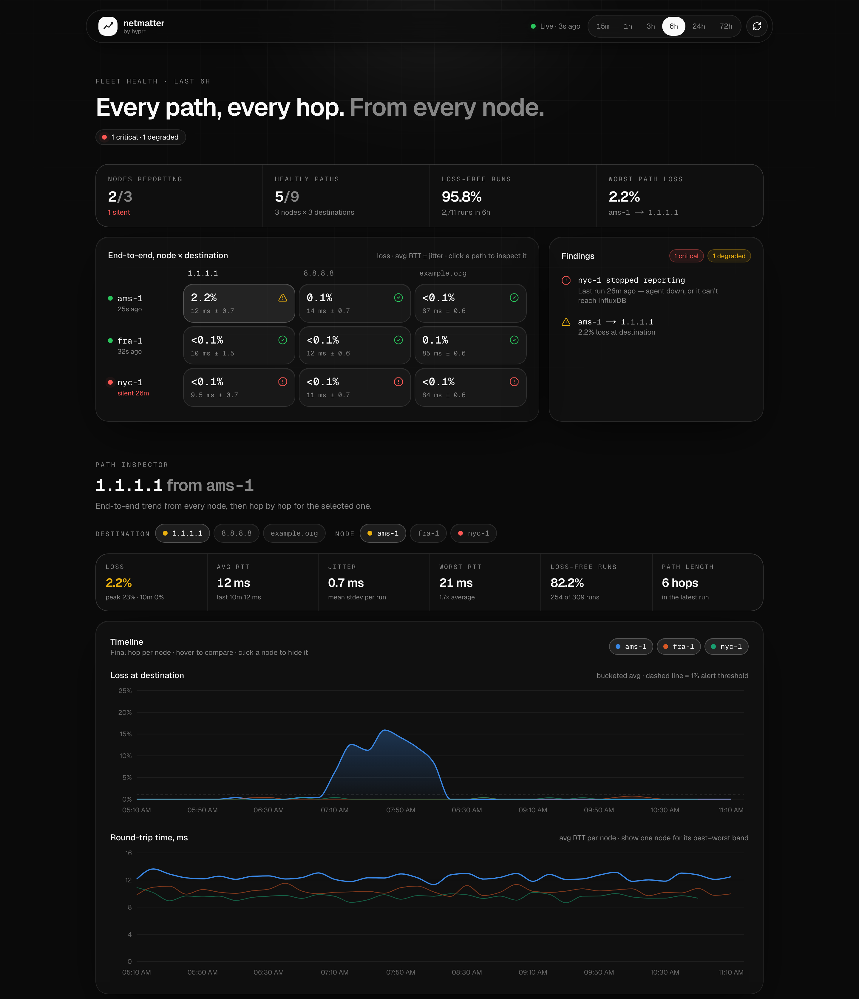

# netmatter — multi-node MTR monitor

Distributed network-path monitor. A lightweight **agent** runs [`mtr`](https://github.com/traviscross/mtr)
on each of your nodes and writes per-hop packet-loss/latency to a **central InfluxDB 3 Core**
database. A purpose-built **Next.js + shadcn dashboard** visualizes packet loss over time,
per node and per hop. The official InfluxDB 3 Explorer UI is available optionally for ad-hoc SQL.

```
  node A ─┐   (mtr + writer, --net=host)
  node B ─┼──HTTP:8181 (token)──►  influxdb3-core ──►  Next.js dashboard  :3000
  node C ─┘                         [central server, one host]   (Explorer :8080 optional)
```

Every point carries a **`node`** tag, so data from all nodes lands in one database and stays
separable.



## Architecture

| Role      | Runs                                    | Where                | Image |
|-----------|-----------------------------------------|----------------------|-------|
| Server    | InfluxDB 3 Core (`influxdb:3-core`)     | one central host     | official |
| Agent     | Alpine: `mtr` + `agent.py` writer       | every monitored node | `ghcr.io/hyprrspace/netmatter-agent` |
| Dashboard | Next.js + shadcn charts                 | central host, :3000  | `ghcr.io/hyprrspace/netmatter-dashboard` |

### Data schema
Single measurement **`mtr`**:
- **Tags:** `node`, `destination`, `hop` (hop is `NN-host`, zero-padded so >9 hops sort right)
- **Fields:** `loss`, `snt`, `last`, `avg`, `best`, `wrst`, `stdev`

Prebuilt agent and dashboard images are published to GHCR by CI on every push to `main`
(and on version tags) — see [`.github/workflows/build-images.yml`](.github/workflows/build-images.yml).
The agent image is multi-arch (`amd64` + `arm64`).

---

## 1. Set up the central server

On the central host (in `server/`):

```bash
cd server
docker compose up -d influxdb3

# Create an admin token — it is shown ONCE, save it somewhere safe:
docker compose exec influxdb3 influxdb3 create token --admin

# Create the database (or let the first agent write auto-create it):
docker compose exec influxdb3 influxdb3 create database mtr --token <apiv3_...>

# Point the dashboard at the token and start it:
echo "INFLUX_TOKEN=<apiv3_...>" > .env
docker compose up -d dashboard
```

Then open the dashboard at **http://&lt;server&gt;:3000**.

Optionally start the InfluxDB 3 Explorer UI for ad-hoc SQL:
`docker compose --profile explorer up -d explorer` → **http://&lt;server&gt;:8080**
(connect it to `http://influxdb3:8181` with the token + database `mtr`).

> **InfluxDB 3 Core note:** Core has no compaction and limits each query to a ~72h range —
> ideal for recent connectivity, not long-term trend history. For full history switch the
> `influxdb3` image to `influxdb:3-enterprise` (free for at-home/non-production use);
> nothing else changes.

---

## 2. Run an agent on each node

Use the published image (or build locally from `agent/`):

```bash
docker run -d --name mtr-agent --restart=unless-stopped \
  --net=host --cap-add=NET_RAW \
  -e INFLUX_HOST=http://<server>:8181 \
  -e INFLUX_TOKEN=apiv3_... \
  -e INFLUX_DATABASE=mtr \
  -e NODE_NAME=$(hostname) \
  -e MTR_HOSTS=8.8.8.8,reddit.com,facebook.com \
  ghcr.io/hyprrspace/netmatter-agent:latest
```

- `--cap-add=NET_RAW` lets `mtr` open raw sockets.
- `--net=host` gives the container the node's real routing and identity.
- To build locally instead: `docker build -t mtr-agent ./agent`.

### Agent configuration (env vars)

| Variable          | Default            | Meaning                               |
|-------------------|--------------------|---------------------------------------|
| `INFLUX_HOST`     | `http://localhost:8181` | Central InfluxDB 3 URL           |
| `INFLUX_TOKEN`    | *(required)*       | Admin/write token (`apiv3_...`)       |
| `INFLUX_DATABASE` | `mtr`              | Target database                       |
| `NODE_NAME`       | container hostname | Value of the `node` tag               |
| `MTR_HOSTS`       | `8.8.8.8`          | Comma-separated destinations to probe |
| `MTR_CYCLES`      | `30`               | Pings per mtr report                  |
| `INTERVAL`        | `40`               | Seconds between rounds                |

---

## 3. The dashboard

A dark, single-page view built to answer "is something wrong, and where?". It reads only
the `mtr` measurement, and the InfluxDB token stays server-side in the `/api/*` route
handlers. Data auto-refreshes every 30s (paused while the tab is hidden). The selected range,
destination and node live in the URL, so you can share a link to a view.

**Fleet health** (time range 15m / 1h / 3h / 6h / 24h / 72h)
- **Stats strip**: nodes reporting, healthy paths, share of runs with no loss, and the worst path.
- **Node × destination matrix**: end-to-end loss, average RTT ± jitter and a status for every
  path. Click a cell to inspect that path.
- **Findings**: problems ranked by severity:
  - agents that stopped reporting (silent > 5 min is degraded, > 15 min is critical);
  - loss at the destination (≥ 1% is degraded, ≥ 5% is critical) and destinations that stopped answering;
  - high jitter (stdev ≥ 10 ms);
  - latency regressions (last 10 min ≥ 1.5× the range average);
  - loss bursts;
  - destinations that are lossy from every node, which points at the far end rather than your side.

**Path inspector** (one destination; opens on the worst path by default)
- KPIs for the selected node → destination: loss (avg / peak / last 10 min), RTT, jitter,
  worst RTT, loss-free runs and path length.
- **Timeline**: final-hop loss and RTT per node on a synced crosshair. Click a node to hide it.
  With one node visible, a best–worst RTT band is drawn. Gaps mean the agent sent no data.
- **Hop × time heatmap**: where in the path loss (or a latency spike above the hop's own
  median) appears, and when.
- **Hop table** (MTR-style): loss, peak, avg/best/worst RTT, jitter and the latency each hop
  adds, plus an automatic verdict per hop:
  - `loss starts`: loss first appears here and carries through to the destination, so look here;
  - `ICMP rate-limit`: loss that later hops don't show, meaning the router deprioritises replies to mtr and traffic is unaffected;
  - `+N ms` / `slow reply`: a latency step that persists, or one slow router that doesn't affect the path;
  - `N routes` / `seen x%`: the path changed during the window.

Thresholds live in `dashboard/lib/health.ts`.

### Run the dashboard locally (bun)

```bash
cd dashboard
bun install
cp .env.example .env.local      # set INFLUX_TOKEN (and INFLUX_HOST if not localhost)
bun dev                         # http://localhost:3000
```

Server-side env vars: `INFLUX_HOST` (default `http://localhost:8181`), `INFLUX_TOKEN`
(required), `INFLUX_DATABASE` (default `mtr`).

### Ad-hoc SQL

The store is plain SQL (Explorer UI or `influxdb3 query`):

```sql
-- packet loss by node for a destination, last hour
SELECT node, hop, avg(loss) AS loss
FROM mtr
WHERE destination = '8.8.8.8' AND time > now() - INTERVAL '1 hour'
GROUP BY node, hop
ORDER BY node, hop;
```

---

## Repository layout

| Path        | What                                                                 |
|-------------|---------------------------------------------------------------------|
| `agent/`    | `mtr` probe + InfluxDB 3 writer (`agent.py`), Alpine `Dockerfile`.   |
| `server/`   | `docker-compose.yml` — InfluxDB 3 + dashboard (+ optional Explorer). |
| `dashboard/`| Next.js + shadcn UI; `app/api/*` query InfluxDB, `components/*` chart. |
| `.github/`  | CI that builds & pushes the agent and dashboard images to GHCR.     |

## Requirements
- Docker on the central host and on each agent node.
- `mtr` and the Python writer are bundled in the agent image — nothing to install on nodes.
- The dashboard runs on the central host (Docker `dashboard` service, or `bun dev` locally).
